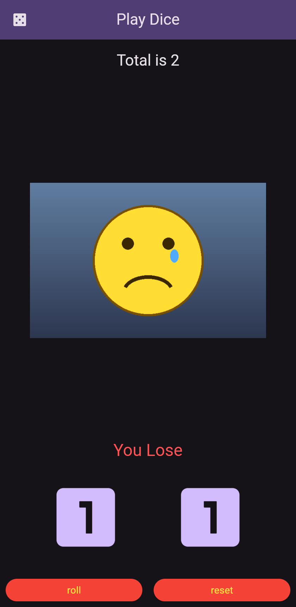
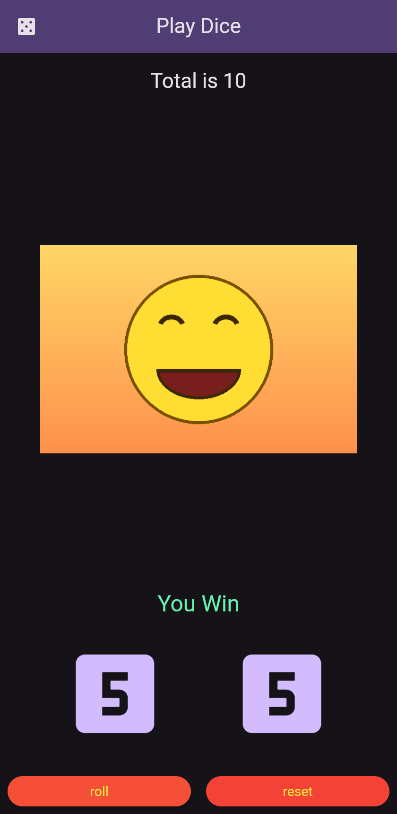

# Play Dice – Flutter (Section 2 task)

**Live demo:** https://mohamedahmed2059.github.io/flutter-dice-game-app/

The player rolls two dice. If the total is **10 or more** the app shows a happy image and "You Win", otherwise a sad image and "You Lose".

| Start (total 2) | After a winning roll |
|---|---|
|  |  |

## Features
- `MyApp` (StatelessWidget) returns the `MaterialApp`.
- `DiceScreen` is a StatefulWidget with its own State class (`_DiceScreenState`).
- `Dice` lives in its own file (`lib/dice.dart`). It's a StatelessWidget that receives a value from 1 to 6 through its constructor and shows it as an icon.
- AppBar with the title "Play Dice" centered and a dice icon (`Icons.casino`) on the left.
- "Total is X" text, a happy or sad image, the two dice spread evenly, and the **roll** / **reset** buttons each taking half of the width with a gap between them.
- **roll** generates two random numbers from 1 to 6 (`Random().nextInt(6) + 1`) and updates the total and the image path inside `setState`.
- **reset** returns both dice to 1, the total to 2 and the image to the sad one.

### Bonus
- Dark look with `brightness: Brightness.dark` inside `ColorScheme.fromSeed`.
- Buttons styled with `ElevatedButton.styleFrom(backgroundColor: ..., foregroundColor: ...)`.
- Total text uses `Theme.of(context).textTheme`.
- "You Win" / "You Lose" under the image.

## Project structure
```
lib/
  main.dart   -> MyApp + DiceScreen
  dice.dart   -> Dice widget
assets/
  images/
    happy.png
    sad.png
pubspec.yaml  -> registers assets/images/
```

## Run it
```bash
flutter pub get
flutter run
```
